# 药物靶点预测

今天给大家介绍几个用于预测化合物靶点的工具

# 一.SwissTargetPrediction
地址：[http://swisstargetprediction.ch/ ](http://swisstargetprediction.ch/ )

该工具只需要提供分子的SMILES点提交就可以啦，很简单，有3个物种可供选择。

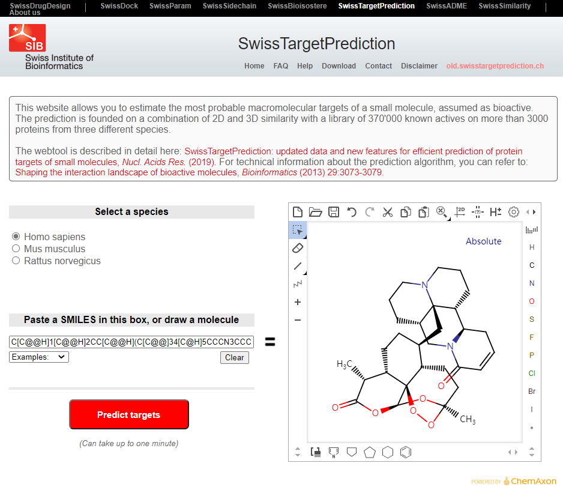

提交后需要等待2分钟，结果页面首页是对预测靶点分类的扇形图。

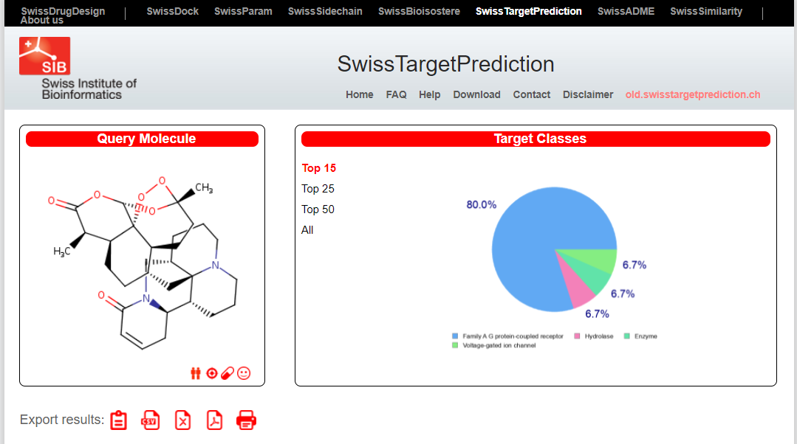

下面就是靶点的详细列表。可以通过show来选择每页展示的个数。

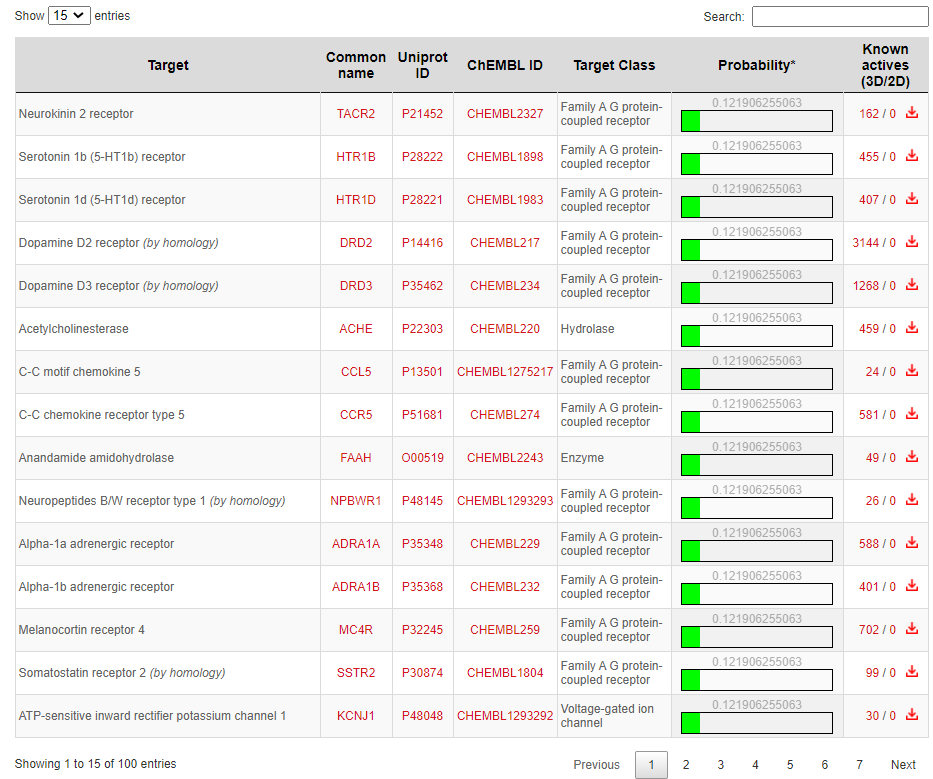

---

参考文献：

【1】SwissTargetPrediction: updated data and new features for efficient prediction of protein targets of small molecules, Nucl. Acids Res. (2019). 

【2】For technical information about the prediction algorithm, you can refer to: Shaping the interaction landscape of bioactive molecules, Bioinformatics (2013) 29:3073-3079.

# 二. SuperPred
地址：[https://prediction.charite.de/index.php?site=chemdoodle_search_target](https://prediction.charite.de/index.php?site=chemdoodle_search_target)

SuperPred，这是一个预测ATC代码和化合物目标预测的网络服务器。预测小分子的ATC编码或靶标，从而获得化合物的信息，有助于药物开发过程。网络服务器的ATC预测和目标预测是基于机器学习模型，使用逻辑回归和ECFP4指纹。

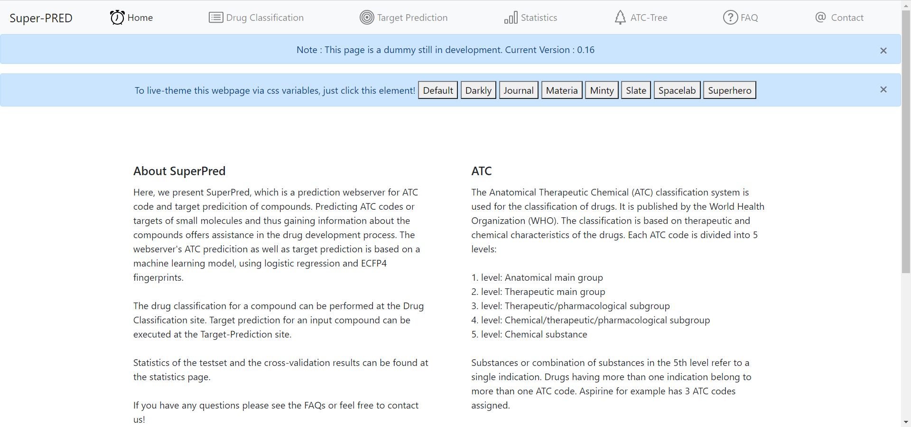

# 三.SEA
SEA(Similarity ensemble approach)SEA数据库整合了ChEMBL和MDDR(MDL Drug Data Report)等数据库的化合物和靶点信息，利用Daylight分子指纹计算化合物的相似性，并将相似化合物的靶点进行聚类。

网站主页：[http://sea.bkslab.org/](http://sea.bkslab.org/)

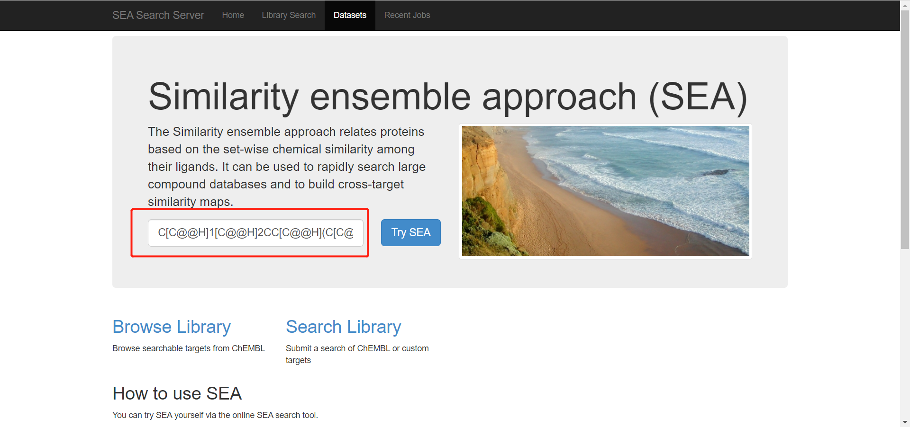

结果页面如下：

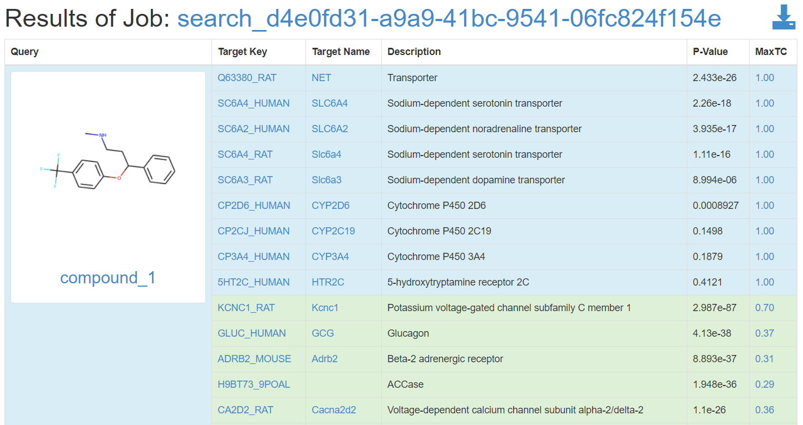

淡蓝色背景是已知的靶点，暗草绿色背景和白色背景是预测的靶点，按照MaxTC值从大到小排序。结果中P-Value越小，潜在靶标的可靠性越大。MaxTC值表示数据库中和查询分子的相似程度。可以点击右上角的下载按钮下载所有结果。

# 四. TargetHunter
TargetHunter是基于小分子二维结构相似性的靶标搜寻工具，该工具比较老了。

地址：[https://www.cbligand.org/TargetHunter/search_target.php](https://www.cbligand.org/TargetHunter/search_target.php)

可以上传分子文件，也可以自己画，也可以是分子的SMILES，然后点击提交就可以啦。

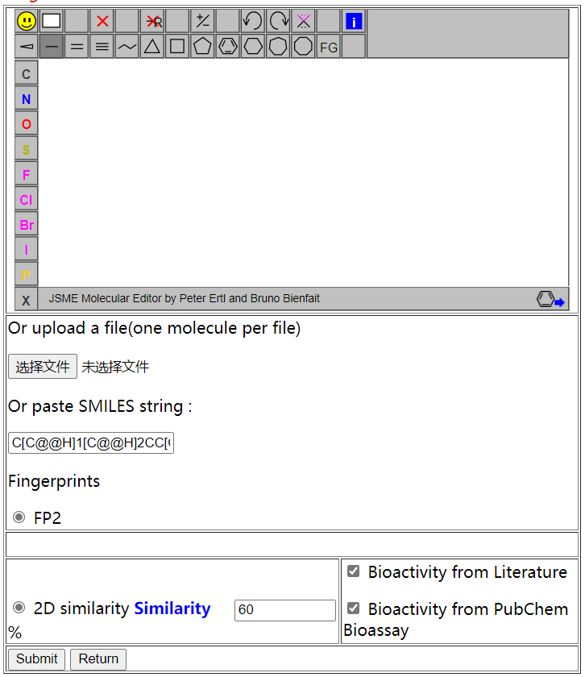

然后就会得到靶点信息。还有参考文章。

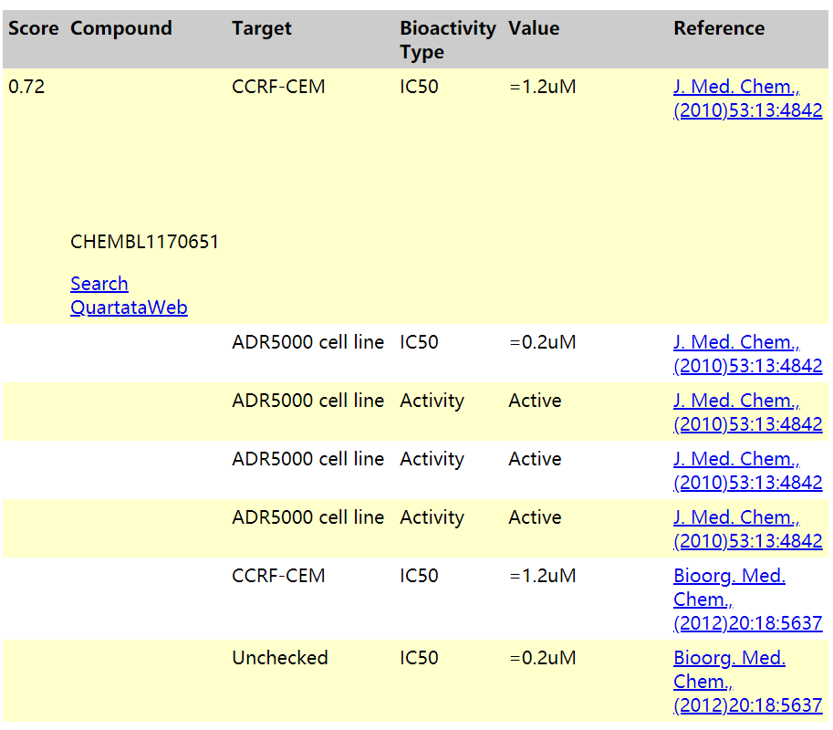

# 五.PharmMapper
PharmMapper服务器是一个免费访问的web服务器，设计用于识别给定探针小分子(药物、天然产物或其他新发现的靶标尚未识别的化合物)的潜在靶标，使用药效团映射方法。得益于高效和稳健的映射方法，PharmMapper具有高通量能力，可以在数小时内从数据库中识别出潜在的候选靶标。

从TargetBank、DrugBank、BindingDB和PDTD的所有靶标中提取的大量内部药效基因库支持了PharmMapper。超过7000个基于受体的药效团模型(包括1627个药物靶点信息，其中459个是人类蛋白靶点)被pharmacmapper存储和访问。PharmMapper根据PharmTargetDB中的所有靶标找到用户上传的分子的最佳映射位(Tripos Mol2或MDL SDF格式)，并输出前N个潜在药物靶标以及各自分子的对齐位。

地址：[http://lilab-ecust.cn/pharmmapper/](http://lilab-ecust.cn/pharmmapper/)

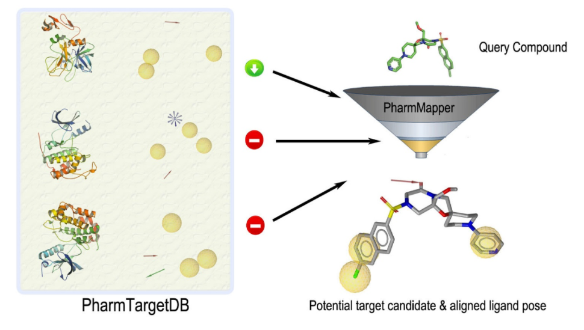

提交分子文件，留个邮箱，结果以电子邮件的形式发送给你。

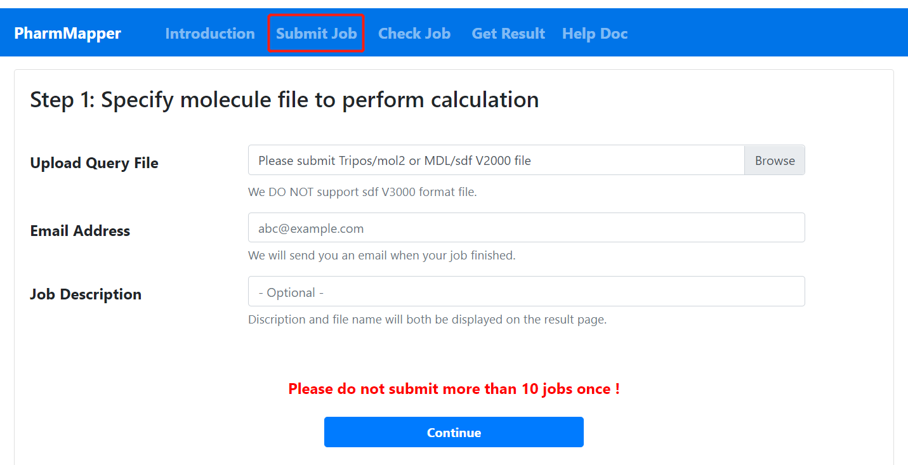

# 六.ChemMapper
ChemMapper是一个用于计算药物发现的免费web服务器，基于具有高3D相似性的化合物可能具有相对相似的目标关联谱的概念。ChemMapper整合了来自不同来源的近30万种化学结构，并附有药理学注释，以及来自商业和公共化学目录的300多万种化合物。ChemMapper采用内部的shaft方法，结合分子形状叠加强度和化学特征匹配，进行三维相似性搜索、排序和叠加。将用户提供的化学结构作为查询，shaft将数据库中的每个目标化合物对齐到查询中，计算3D相似度评分，并返回最相似的结构。基于这些具有药理学注释的最相似结构，构建化学-蛋白质网络，并采用随机游走算法计算查询结构与与命中化合物相关的蛋白质相互作用的概率。这些潜在的蛋白质目标按概率的标准得分排列。ChemMapper可用于多种多药理学、药物再利用、化学靶点关联、虚拟筛选和支架跳跃研究。

地址：[http://lilab-ecust.cn/chemmapper/](http://lilab-ecust.cn/chemmapper/)

提交分子结构和前面一样

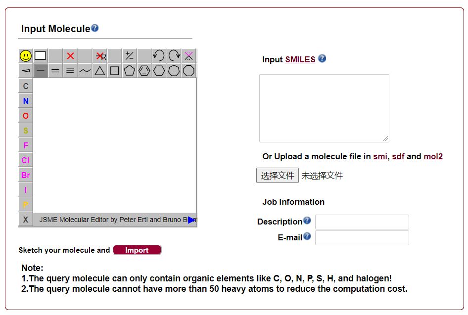

然后选择方法和数据库，点击提交就可以啦。

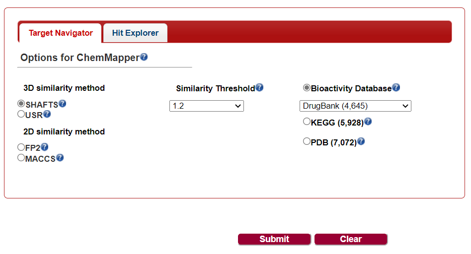

> 更新: 2021-07-07 16:05:44  
> 原文: <https://www.yuque.com/doublehelix/bioinfonotes/fny8tm>