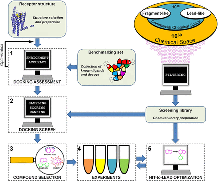

# 虚拟筛选

分子对接是基于结构的配体设计的核心方法，它既可用于筛选化学文库中的配体，也可用于模拟蛋白质与配体之间的相互作用。分子对接算法基于蛋白质的结构，旨在预测配体的结合模式和复合物的亲和力。如果这是可能的，这项技术将彻底改变基于靶点的药物发现。用高通量筛选(HTS)代替实验筛选化学文库，具有最高亲和力的化合物将被快速识别。然而，为了筛选大型化学库，对接方法需要牺牲精确度来提高速度。目前，分子对接评分函数无法准确预测配体亲和性。对接应该被看作是从库中筛选出不太可能的配体，从而丰富前列活性化合物的一种方法。绝大多数预测的配体应该是无活性的，5%-10% 的命中率(即实验评估的活性化合物的百分比)是一个成功的结果。尽管假阳性率很高，分子对接筛选已经证明能够识别重要靶标的新配体，现在已经成为一种工具，与其他主流发现方法如 HTS相互补充。在这一部分，我们介绍了分子对接方法，并描述了基于结构的虚拟屏幕的实际步骤。

# 1.分子对接方法
分子对接预测配体在受体结合位点的方向和构象，分为取样和划分两步。在取样过程中，受体表面产生大量的配体位点，形成数以千计的配合物。配合物的最可能的结构，以及配体的亲和力，预测在评分步骤。绑定亲和力是近似使用简化的评分函数，这些评分函数是基于物理或校准的实验数据。分子对接预测受体结合位点中配体的取向和构象，可分为两个步骤：取样和评分。在取样步骤中，在受体表面上产生大量配体姿势，导致数千种可能的复合物。在评分步骤中预测复合物的最可能结构以及配体亲和力。使用基于物理或基于实验数据校准的简化评分函数来近似结合亲和力（Kitchen等人，2004）。DOCK是最早能够对蛋白质-配体复合物进行计算预测的对接程序之一，它是在八十年代开发的（Kuntz等，1982）。今天，有大量具有不同采样算法和评分函数的对接程序。表1列出了几种广泛使用的对接程序。

| **Docking Software** | **Website** |
| --- | :---: |
| AutoDock (Morris et al., 2009) | [http://autodock.scripps.edu](http://autodock.scripps.edu/) |
| AutoDock Vina (Trott and Olson, 2010) | [http://vina.scripps.edu](http://vina.scripps.edu/) |
| DOCK (Coleman et al., 2013) | [http://dock.compbio.ucsf.edu](http://dock.compbio.ucsf.edu/) |
| FlexX (Rarey et al., 1996) | [https://www.biosolveit.de/FlexX](https://www.biosolveit.de/FlexX) |
| FRED (McGann, 2011) | [https://www.eyesopen.com/oedocking](https://www.eyesopen.com/oedocking) |
| Glide (Friesner et al., 2004) | [https://www.schrodinger.com/glide](https://www.schrodinger.com/glide) |
| GOLD (Jones et al., 1997) | [https://www.ccdc.cam.ac.uk/solutions/csd-discovery/components/gold](https://www.ccdc.cam.ac.uk/solutions/csd-discovery/components/gold) |
| ICM (Abagyan et al., 1994) | [http://www.molsoft.com/docking.html](http://www.molsoft.com/docking.html) |
| MOE [Molecular Operating Environment (MOE), 2020] | [https://www.chemcomp.com](https://www.chemcomp.com/) |
| PLANTS (Korb et al., 2009) | [https://uni-tuebingen.de/fakultaeten/mathematisch-naturwissenschaftliche-fakultaet/fachbereiche/pharmazie-und-biochemie/pharmazie/pharmazeutische-chemie/pd-dr-t-exner/research/plants](https://uni-tuebingen.de/fakultaeten/mathematisch-naturwissenschaftliche-fakultaet/fachbereiche/pharmazie-und-biochemie/pharmazie/pharmazeutische-chemie/pd-dr-t-exner/research/plants) |
| Surflex-Dock (Jain, 2003) | [https://www.biopharmics.com](https://www.biopharmics.com/) |

为了启用大型化学库的筛选，对接程序在采样和评分步骤中进行了许多近似。通常完全忽略蛋白质的柔韧性。配体被视为柔性的，但是只能探索有限的构象集合，并且搜索空间被限制到预定的结合位点体积。对接评分函数从复合物的单一结构预测配体亲和力，并且对配体结合有贡献的能量项的描述只是近似的。捕获受体-配体相互作用（例如，氢键和范德华相互作用）的术语是所有评分函数的主要组分。没有准确描述或忽略几种溶剂（例如，结合位点去溶剂化）和熵（例如，来自限制复合物中的配体和结合位点柔性）对配体结合的贡献。克服对接方法弱点的方法的发展仍然是一个活跃的研究领域，已在其他地方进行了评论（Leach等，2006；Pantsar和Poso，2018；Salmaso和Moro，2018；Zhenin等，2018）。例如，可以通过使用共识技术（Feher，2006），通过对筛选的文库的子集应用更严格的评分方法（Zhong等人，2010），或通过诸如交互指纹的过滤器（Deng等人）来改进预测。通过将侧链视为柔性（Ravindranath等，2015）或通过对接受体构象集合（Totrov和Abagyan，2008），可以至少部分地考虑结合位点可塑性。还作出了重大努力来捕捉结合场地水域的贡献。被鉴定为对配体识别重要的水分子可以作为结合位点的一部分进行处理（Verdonk等，2005；Huang和Shoichet，2008），并且考虑水置换的能量贡献可以改善预测（Abel等，2008；Balius等，2017）。

# 2.基于结构的虚拟筛选工作流程
分子对接筛选的关键步骤是: 1)化学库的设计，2)受体结构的选择和准备，3)对接性能的评价，4)对接筛选和化合物的选择，5)实验评价，6)命中引导优化。在本节中，我们将描述如何执行预期的虚拟屏幕，以及在每个步骤中的重要注意事项。

预期分子对接屏幕的工作流程。在第一步（1）中，鉴定了相关的受体结构。如果实验结构不可用，则可以探索计算导出的模型。基于复合物和已知配体的可用结构（重做和配体富集计算）的回顾性对接筛选用于优化虚拟筛选性能。在第二步（2）中，选择化学文库，并通过对接筛选化合物。在第三步（3）中，基于预测的结合模式，新颖性和多样性分析来自对接屏幕的排名靠前的化合物。然后选择一组化合物进行实验评估。在第四步（4）中，在实验测定中评估化合物。领先优化步骤（5）通常是迭代的，涉及测试SAR引导的几个化合物集。

## （1）化合物库
筛选库定义将由对接屏幕探索的化学空间区域。筛选库的典型来源是内部收藏和市售化合物。表2列出了商业化学图书馆在线资源的例子。目前有数百万种化合物可供储存，例如在ZINC数据库中（Irwin等，2020），并可由化学品供应商立即交付。具有易于合成的分子的按需制造库提供了化学空间的额外覆盖。或者，可以基于可用的构建块在内部生成虚拟库。来自化学供应商的商业按需制造库目前达到>200亿种化合物，可以在1个月内定制合成和交付，例如Enamine实空间数据库（Hoffmann和Gastreich，2019；Grygorenko等，2020）。

| **Database** | **Website** |
| --- | :---: |
| Chemspace | [https://chem-space.com](https://chem-space.com/) |
| Enamine REAL | [https://www.enaminestore.com/search#real](https://www.enaminestore.com/search#real) |
| eMolecules | [https://www.emolecules.com](https://www.emolecules.com/) |
| MolPort | [https://www.molport.com/shop/find-chemicals](https://www.molport.com/shop/find-chemicals) |
| ZINC | [https://zinc20.docking.org](https://zinc20.docking.org/) |

化学库的设计取决于几个因素。许多虚拟筛选活动的最终目标是鉴定具有类似药物性质的高亲和力化合物，例如，如Lipinski的5规则所定义的（Lipinski等人，2001）。化学文库的选择决定了鉴定配体的途径。筛选文库通常基于一组物理化学性质产生，例如计算的辛醇/水分配系数（log P）和分子量。具有片段和铅样特性的化学文库子集是配体发现的常见起点（Hann和Oprea，2004；Keserű等，2016）。基于片段的药物发现最初集中于大约一半药物大小的化合物（摩尔重量<250Da）。片段库的筛选导致更高的命中率(∼比HTS高2%–8%），但鉴定出的配体通常亲和力较弱，需要进行优化才能获得有效的lead（Erlanson等，2016；Keserű等，2016）。含lead化合物的文库（mol.wt。∼250-350Da）在性质空间中更接近最终的药物样分子（摩尔重量<500Da），并且高亲和力配体可以直接从筛选中出现，但是以命中率和化学空间覆盖率为代价（Teague等，1999）。除了物理化学性质过滤器之外，通过使用关于已知配体和结合位点的信息，可以针对特定靶标定制文库。这可以使用已经在别处评论过的基于配体的虚拟筛选方法（例如药效团，定量结构-活性关系或化学相似性方法）来实现（Cherkasov等，2014；Muratov等，2020）。以目标为中心的文库（Harris et al。，2011）可以提高筛选命中率并降低对接屏幕的计算成本，但可能会降低识别新型化学型的机会。库设计中的另一个重要步骤是去除可能导致实验伪影的分子。已经鉴定出由于测定干扰或胶体聚集而导致假阳性的化学型（McGovern等，2002；Baell和Holloway，2010），并且在某种程度上可以使用化学信息学工具过滤掉。表3列出了用于识别此类化合物的有用网络服务器。ZINC数据库提供来自多个供应商的预生成片段和lead样化学文库（Irwin等，2020）

> 更新: 2022-04-15 11:25:46  
> 原文: <https://www.yuque.com/doublehelix/bioinfonotes/ygia84>