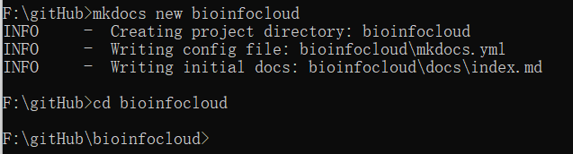
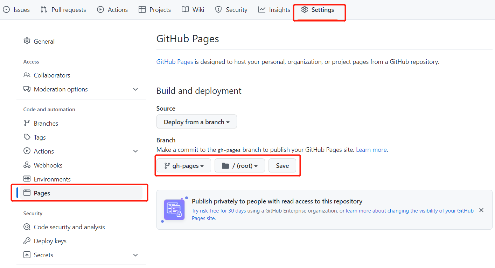

# github搭建静态网页

Material for MkDocs官方文档

[https://www.mkdocs.org/getting-started/](https://www.mkdocs.org/getting-started/)
https://squidfunk.github.io/mkdocs-material/getting-started/
GitHub Pages 简介
https://yang-xijie.github.io/BLOG/Markdown/github-pages/
mdBook构建示例
https://yang-xijie.github.io/BLOG/Markdown/mdbook-site/
mdBook官方文档
https://rust-lang.github.io/mdBook/
MkDocs构建示例
https://yang-xijie.github.io/BLOG/Markdown/mkdocs-site

# 1.安装MKdocs

[https://www.mkdocs.org/user-guide/installation/](https://www.mkdocs.org/user-guide/installation/)

```r
pip install mkdocs
```

# 2.Creating a new project
```r
mkdocs new bioinfocloud
cd bioinfocloud
```



There's a single configuration file named mkdocs.yml, and a folder named docs that will contain your documentation source files (docs is the default value for the [docs_dir](https://www.mkdocs.org/user-guide/configuration/#docs_dir) configuration setting). Right now the docs folder just contains a single documentation page, named index.md.

MkDocs comes with a built-in dev-server that lets you preview your documentation as you work on it. Make sure you're in the same directory as the mkdocs.yml configuration file, and then start the server by running the mkdocs serve command:

```r
mkdocs serve
```

**现在尝试编辑配置文件:mkdocs.yml。将site_name设置更改为BioInfoCloud并保存文件。**

```r
site_name: BioInfoCloud
site_url: https://example.com/
```

3.

```r
mkdir .github
cd .github
mkdir workflows
cd workflows
```

在workflows目录下创建一个yml文件，文件名自定义，文件内容为：

```r
name: publish site
on: # 在什么时候触发工作流
  push: # 在从本地main分支被push到GitHub仓库时
    branches:
      - main
  pull_request: # 在main分支合并别人提的pr时
    branches:
      - main
jobs: # 工作流的具体内容
  deploy:
    runs-on: ubuntu-latest # 创建一个新的云端虚拟机 使用最新Ubuntu系统
    steps:
      - uses: actions/checkout@v2 # 先checkout到main分支
      - uses: actions/setup-python@v2 # 再安装Python3和相关环境
        with:
          python-version: 3.x
      - run: pip install mkdocs-material # 使用pip包管理工具安装mkdocs-material
      - run: mkdocs gh-deploy --force # 使用mkdocs-material部署gh-pages分支
```

Adding pages

Now add a second page to your documentation:

```r
curl 'https://jaspervdj.be/lorem-markdownum/markdown.txt' > docs/about.md
```

# 3.Git and GitHub[¶](https://yang-xijie.github.io/BLOG/Markdown/mkdocs-site/#git-and-github)
```r
$ git init
$ git add .
$ git commit -m "init"
```

**GitHub - New Repository**[**¶**](https://yang-xijie.github.io/BLOG/Markdown/mkdocs-site/#github-new-repository)

GitHub > New Repository

GitHub > Repository > Settings > Actions > General >

+ Actions permissions: Allow all actions and reusable workflows
+ Workflow permissions: Read and write permissions
+ Click Save

设置Page



```r
$ git remote add origin git@github.com:BioInfoCloud/bioinfocloud.git # change to your github repo
$ git branch -M main
$ git push -u origin main
```

# 4.主题

[https://squidfunk.github.io/mkdocs-material/getting-started/](https://squidfunk.github.io/mkdocs-material/getting-started/)

```r
pip install mkdocs-material
git clone https://github.com/squidfunk/mkdocs-material.git
pip install -e mkdocs-material
```

5.其他发布平台

[https://www.netlify.com/](https://www.netlify.com/)

> 更新: 2022-10-02 09:45:12
> 原文: <https://www.yuque.com/doublehelix/bioinfonotes/lf2277>
